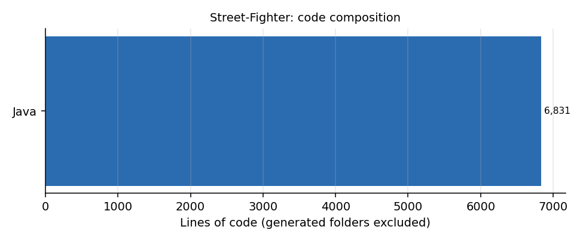

# Street-Fighter

**Object-oriented Java exercise: a console Street Fighter battle simulator with 34 characters.** *Em portugues: exercicio de orientacao a objetos em Java, simulador de lutas de Street Fighter no console.*

## How it is built

| Piece | Role |
|---|---|
| `Personagem.java` | Base class with the fixed attributes (power, health, mobility, techniques, range, description) and the variable ones (life bar, damage, defence flag, speed, alive flag, x/y position in the arena) with accessors |
| One class per fighter (`Ryu`, `Ken`, `ChunLi`, `MBison`, `Guile`, `Zangief`, ... 34 in total) | Each extends `Personagem` and sets its own attributes |
| `Arena.java` | Entry point: lists the fighters, reads two names and starts the fight |
| `ScriptBatalhas.java` | Runs the battle for the chosen pair and prints the stats and the rounds |
| `FuncoesAuxiliares.java` | Helpers shared by the battles |



## Run

```bash
javac -d out src/*.java
java -cp out Arena
```

## Honest scope

A teaching project for inheritance and encapsulation. The battles in `ScriptBatalhas` are written out pair by pair (a large `switch`), which is the main thing a refactor would remove: the natural next step is a data-driven fighter table and one generic battle loop.
